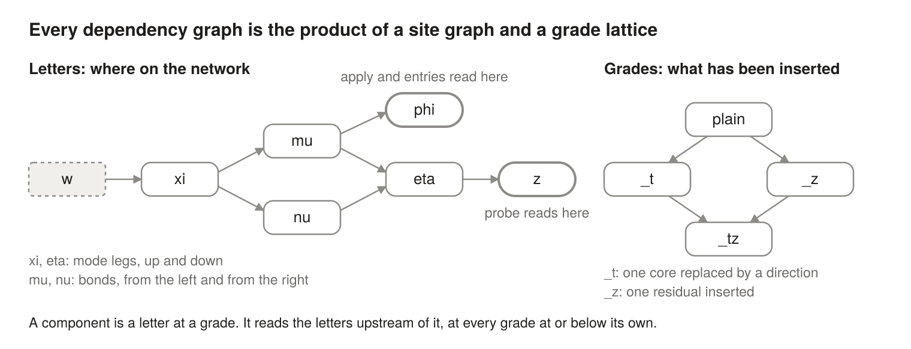
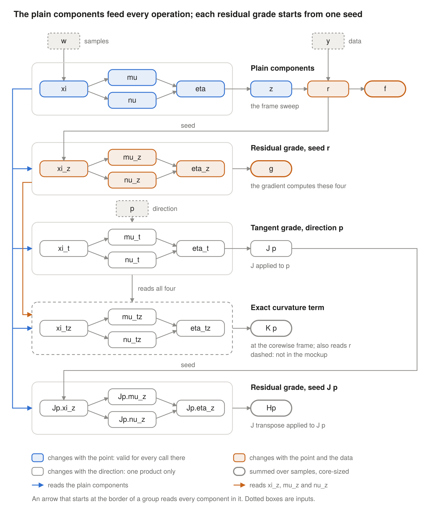

# Evaluator: components, dependency graphs, want and have

> **Status after the review of 2026-11-14: this document describes the design before the review.** Read [DESIGN_AFTER_REVIEW.md](DESIGN_AFTER_REVIEW.md) first. Where the two disagree, that one wins. This document has not been rewritten.
>
> What no longer holds here:
>
> - **`evaluate(..., want, have=dict)` returning a dict.** It is now `sampling_variables(kind, ..., want=(names), name=array, ...)`, returning a tuple aligned with `want`, with held variables as keyword arguments.
> - **The names.** "Components" are "sampling variables". The suffixes `_t` and `_z` are `_dot` and `_tilde`, and the letter under the tilde does not mean what it means in the library today. See section 3 of the design document.
> - **The `centers` argument, and reading the probe output off the frame.** Parked. The value is computed through the base point's own cores, with the new variable `gamma`.
> - **"Three savings need no memory."** They were examined and declined in the library's own caching audit, and two presuppose held per-sample variables (D8, F21).
> - **`Hp` and the projection inside the evaluator.** The sampling layer returns the blocks before the gauge projection. The Gauss-Newton product is `JtJp`. `Hp` is the exact product and is assembled by `LocalModel`.
> - **The `Jp.` prefix for copies.** Only the tilde variables seeded by the residual are public.
> - **The loss without weights.** Weighted least squares is built in.
> - **The mockup section.** It describes `scripts/plan_mockup.py`, which is not rewritten either.
>
> What still stands: the grid of which variables each case needs, the reuse identities between frames, the sharing analysis, and the parked idea.
>
> Known errors, from the reviewers: the "one rule" for the dependency graph is an upper bound, and the drawn graph of the exact term contradicts the reuse table (D4). "A larger part, not yet counted": the library has counted it, at about +60% of the jet sweep resident for about 10 to 15% of the two-hole, with the `nu` re-sweep at 1 to 3% of the two-hole (F15). The Gauss-Newton product the optimizer runs is the backend `LocalModel.hvp`, not the frontend `gn_hessian` (F14). MiB is labelled MB next to an "8 MiB budget", and the `fill` total of 7.34 exceeds its own target of 7.2 (D8, D10).

Added 2026-11-14, against T3Toolbox commit `3dc15d9`. Companion to [EXECUTION_PLANS.md](EXECUTION_PLANS.md) (how a call is executed), [PROPOSAL.md](PROPOSAL.md) and [WORKED_EXAMPLE.md](WORKED_EXAMPLE.md); see [README.md](README.md) for status and how to resume.

Every per-sample intermediate of the sampling layer is a component, named by a letter and a grade. The dependency graph of every case is one small pattern: entries, apply or probe; value, gradient, Gauss-Newton product or exact Hessian term; with or without jets. A call to the evaluator says which components it wants and which it already has.

`scripts/component_graphs.py` derives every graph here by tracing the graded program of `scripts/graded_messages_prototype.py`, which reproduces the library. `scripts/plan_mockup.py` implements the probe case at order 0.

## One pattern

A component is a letter at a grade.

- **The letter says where on the network.** `xi` is a mode leg going up, `mu` a bond from the left, `nu` a bond from the right, `eta` a mode leg going down.
- **The grade says what has been inserted.** Plain is nothing. `_t` is one core replaced by a direction. `_z` is one residual inserted. `_tz` is both.
- **The rule:** a component reads the letters upstream of it, at every grade at or below its own.



So `mu_tz` reads `xi` at all four grades, and `mu`, `mu_t` and `mu_z`. No graph has to be written per case. Each follows from the seven site rules and the product rule.

Three choices fix a case:

| Choice | Options | What it changes |
| --- | --- | --- |
| Readout, set by the sampling kind | the right boundary (apply, entries), or every mode leg (probe) | which letters are needed, and where the residual enters |
| Frame | the manifold frame `(D, U, L, R)`, or the corewise frame `(B, G, G, G)` at the base point | which cores each letter goes through, and so what can be reused |
| Operation | the value, `J p`, `J^T r`, or the exact term `K p` | which grades are wanted |

Jets are not a fourth choice. They put an order axis on every component and add no components and no reads.

## Which components each case needs

"All" means entries, apply and probe. Entries has the same graph as apply in every case.

| Component | Value | `J p` | `J^T r` | Exact `K p` |
| --- | --- | --- | --- | --- |
| `xi` | all | all | all | all |
| `mu` | all | all | all | all |
| `nu` | probe | probe | probe | probe |
| `eta` | probe | probe | probe | no |
| `xi_t` | no | all | no | all |
| `mu_t` | no | all | no | all |
| `nu_t` | no | probe | no | probe |
| `eta_t` | no | probe | no | probe |
| `xi_z` | no | no | probe | probe |
| `mu_z` | no | no | probe | probe |
| `nu_z` | no | no | all | all |
| `eta_z` | no | no | all | no |
| `xi_tz` | no | no | no | probe |
| `mu_tz` | no | no | no | probe |
| `nu_tz` | no | no | no | all |
| `eta_tz` | no | no | no | all |

- **Apply and entries read the output at the right boundary.** The forward needs only the left-to-right letters, `xi` and `mu`. The residual is one scalar per sample and enters at the right boundary, so the adjoint needs only `nu_z` and `eta_z`.
- **Probe reads the output at every mode leg.** It needs both directions at every grade. Its residual enters at the mode legs, as `xi_z`.
- **The operations compose.** The gradient is `J^T r`. A Gauss-Newton product is `J p` followed by `J^T` seeded by `J p`. The exact Hessian adds `K p`.
- **The exact term is the only user of the `tz` rows.** It also needs the `t` and `z` rows, at the corewise frame.

## What each component reads

Sweep components also read themselves at the previous bond. The full lists, with the cores each component goes through, are printed by `scripts/component_graphs.py`.

| Component | Probe | Apply and entries |
| --- | --- | --- |
| `xi` | `w` | the same |
| `mu` | `xi` | the same |
| `nu` | `xi` | not needed |
| `eta` | `mu`, `nu` | not needed |
| the value | `z` reads `eta` | `phi` reads `mu` and the boundary vector |
| `xi_t` | `w` | the same |
| `mu_t` | `xi`, `mu`, `xi_t` | the same |
| `nu_t` | `xi`, `nu`, `xi_t` | not needed |
| `eta_t` | `mu`, `nu`, `mu_t`, `nu_t` | not needed |
| `J p` | `z_t` reads `eta`, `eta_t` | `phi_t` reads `mu_t` and the boundary vector |
| `xi_z` | the residual `r` | not needed |
| `mu_z` | `xi`, `mu`, `xi_z` | not needed |
| `nu_z` | `xi`, `nu`, `xi_z` | `xi` and the scalar residual `c` |
| `eta_z` | `mu`, `nu`, `mu_z`, `nu_z` | `mu`, `nu_z` |
| `J^T r` | `eta`, `eta_z`, `w`, `r`; and `xi`, `mu`, `nu`, `xi_z`, `mu_z`, `nu_z` | `eta_z`, `w`; and `xi`, `mu`, `nu_z` |
| `xi_tz` | `r` | not needed |
| `mu_tz` | `xi` at all four grades; `mu`, `mu_t`, `mu_z` | not needed |
| `nu_tz` | `xi` at all four grades; `nu`, `nu_t`, `nu_z` | `xi`, `xi_t`, `nu_z` |
| `eta_tz` | `mu` and `nu` at all four grades | `mu`, `mu_t`, `nu_z`, `nu_tz` |
| `K p` | `eta_t`, `eta_tz`, `w`, `r`; and `xi`, `mu`, `nu` at all four grades | `eta_tz`, `w`; and `xi`, `xi_t`, `mu`, `mu_t`, `nu_z`, `nu_tz` |

Entries is apply with one-hot sample vectors: `xi` is a column gather, and the Tucker part of the gradient is a scatter-add.

## Frames and reuse

The gradient and the Gauss-Newton product use the manifold frame. The exact term uses the corewise frame at the base point `(D, L)`. A component can be reused between the two when it goes through the same cores.

| Component | Manifold frame | Corewise frame at `(D, L)` | Reusable |
| --- | --- | --- | --- |
| `xi`, `xi_z` | through `D` | through `D` | yes |
| `mu`, `mu_z` | through `L` | through `L` | yes |
| `nu`, `nu_z` | through `R` | through `L` | by a bond-sized gauge matrix |
| `eta`, `eta_z` | through `U` | not needed | no |
| the tangent grade | direction `(V, H)`, through `L`, `R`, `U` | lifted direction, through `L` | no |

The gauge facts, checked numerically by `scripts/reuse_check.py` for probes at order 0:

- **Through the point's own cores, nothing can be reused.** The components are in a different gauge from the frame's, and in general have different ranks.
- **The two `nu` differ by a bond-sized gauge matrix**, `nu_L[i] = S_i nu_R[i]`, where `L_i ... L_{d-1} = S_i R_i ... R_{d-1}`. The same holds for `nu_z`. `S` comes from the frame cores alone, at a cost independent of `W`. Both match to 1e-15.

Some components have a second, cheaper rule when another component is at hand:

- **`nu` through `L`** is `S` applied to `nu` through `R`.
- **The probe value** can be read off the frame: `z[i] = OUT(eta[i], Vc[i])`, with `Vc` the point's Tucker center cores, the second return value of `t3_orthogonal_representations`. It matches `t3_probe` to 2e-15, so the residual and the objective need no sweep through the point's own cores.
- **For apply and entries, `nu_z` is the scalar residual times the plain `nu`**, to 3e-16 (`scripts/component_graphs.py`). The library does not keep `nu` for these kinds and re-sweeps. With `nu` in `have`, the sweep becomes a multiplication.

A declared graph can hold such alternatives. The mockup does not yet.

## Jets

- **Every component gains an order axis. Nothing else changes.** The traced graphs at orders 0 to 2 have the same components and reads as at order 0.
- **Each rule becomes a truncated product over orders.** The leaf jet `w + s p` has two coefficients, so `xi` is affine and its products are cheap. Products of two full jets are convolutions.
- **Residual jets are stored reversed**, which makes the adjoint rules the same products as the forward ones.
- **Within a component, coefficient `k` reads coefficients up to `k`.** How that inner loop runs, sequential or vectorized, is the plan's `orders` option. It is not a graph choice.
- **Sizes multiply by the number of orders**, for kept components as for the data.

## Tucker-factor sharing

In the library, sharing means that several modes use the same Tucker factor. This document uses the word only in that sense.

Sharing needs nothing new from the evaluator. A shared point is an ordinary T3 whose group factors are equal, and the library handles it in a geometry wrapper (`shared_geometry.py`, `backend/sharing.py`); its sampling kernels do not know about it. The same split holds here: the evaluator works per sample, and sharing acts on cores.

Checked with `scripts/sharing_check.py`, for probes at order 0, at a point with three of its four modes in one group:

- **The evaluator runs unchanged at a shared point.** Its gradient and Gauss-Newton product match the unshared geometry's to 2e-15.
- **Sharing is a core-sized step after the sample loop.** The tied projection of those two results matches the shared geometry's gradient and product to 2e-15.
- **The graph, `want` and `have`, and the plan are unaffected.**

What sharing does ask for:

- **The geometry must stay outside the evaluator.** The mockup applies the unshared gauge projection as its last step. The evaluator should return the raw `J^T r` and leave the projection to the geometry, as the library does.
- **The exact term needs the tied lift.** The direction given to the `tz` graph must be one raw factor direction per group, and the normal part of the curvature uses the shared gradient. Both are core-sized steps. They are not checked here, because the mockup has no exact term.
- **Sizes change.** A shared rank can exceed a mode's own ceiling. At the test point the group's Tucker rank is 9, where mode 0 alone could use at most 3. So `xi` for the group's modes is larger than in the unshared case.

One opportunity is recorded under "Parked ideas" at the end of this document: when a group's modes also receive the same sample vector, their `xi` components coincide.

Not checked: apply, entries, jets, the uniform layout, and the fused Gauss-Newton product with tied directions.

## The probe case, drawn

This is the graph the mockup declares: probes at order 0, in the manifold frame, for the objective, the gradient and a Gauss-Newton product. The exact term is drawn dashed.



Blue components change only with the point, so they are valid for every call at that point. Orange ones also change with the data. Grey ones change with the direction and live for one product. The full edge list is also in `dependency_graph.dot`, written by `scripts/plan_mockup.py --dot`.

The residual grade appears twice. Seeded by `r` it gives the gradient `g`. Seeded by `Jp` its components are named `Jp.xi_z` and so on, and it gives `Hp`.

## Want and have

The graph is used through one entry point.

### One entry point

A call says which components it wants and which it already has.

```python
f   = evaluate(frame, centers, w, plan, want=('f',), y=y)['f']             # the objective only

out = evaluate(frame, centers, w, plan, want=('f', 'g') + FRAME, y=y)      # objective and gradient in one pass,
have = {name: out[name] for name in FRAME}                                 # keeping the frame sweep as a by-product

Hp  = evaluate(frame, centers, w, plan, want=('Hp',), p=p, have=have)['Hp']   # Gauss-Newton product
r   = evaluate(frame, centers, w, plan, want=('r',), y=y, have=have)['r']     # per-sample residuals, on request
```

- **`want` names what to compute and hand back.** Summed components (`f`, `g`, `Hp`) come back core-sized. Per-sample components come back for all samples.
- **`have` names what is already known.** Anything else is computed inside a block only if something wanted reads it.
- **Keeping is wanting a per-sample component.** A keep set is any tuple of names. `NOTHING`, `INPUTS` (`xi`) and `FRAME` (the four plain components) are presets, not levels.
- **The residual is the component `r`.** There is no separate flag for it.
- **Fusing is wanting two summed components in one call.** `objective_and_gradient` is `want=('f', 'g')`.
- **Producing kept components needs no separate pass.** They come back from a call that was being made anyway.
- **The usual names stay** as thin wrappers: `objective`, `objective_and_gradient`, `gn_product`.

### The evaluator

The graph is declared as data: each name maps to the names it reads and a rule. So two things are known before anything is computed.

- **Which components are needed.** Walk back from `want`, stopping at `have`.
- **When each is read for the last time.** It is dropped there, so nothing outlives its use, let alone its block.

Any subset of valid components may be handed in, and that is testable. In the mockup the gradient is unchanged under all 512 subsets of the nine keepable components, and the Gauss-Newton product under all 16 subsets of the four it reads.

### Decisions

Decided by the maintainer on 2026-11-14:

- **The plan is passed to every call.** It is not bound into a model object.
- **Kept components are a separate argument**, `have`, not hidden inside the frame or a model.
- **`want` and `have` are arguments of the call. The plan has no `keep` field.** The plan decides how a result is computed and never what is returned.
- **Per-sample residuals are returned only on request**, by wanting `r`. Returning them must be supported; they can be very large, and sometimes only the objective is wanted. (An earlier draft used a `return_residual` flag; it was folded into `want`.)

## Keeping and fusing

### What to keep

Keeping is handing components to a later call through `have`. Inside a block they are one more per-sample input.

- **The sample loop slices them per block** exactly as it slices the data.
- **Only what is read is computed.** That is the lean apply sweep today.
- **The memory model gains one term**, kept bytes per sample times the local number of samples.

A keep set is any set of component names. "What can be kept, by operation" lists them.

The maintainer's lean is larger outer blocks before more caching. Two arguments that do not rest on timing support that as the default priority:

- **The kept components are the part that grows with `W`.** If the main path assumes nothing is kept, the path that scales is the ordinary one.
- **The saving is modest for Gauss-Newton.** At order 0 a product does 21 core-sized and 7 ambient-sized contractions with nothing kept. Keeping the frame sweep removes 3 and 1, about one seventh by count. The jet case has not been counted.

Two qualifications are why it remains a setting:

- **`xi` is nearly free to keep.** It is smaller than the data by about `N/n` and removes one ambient-sized contraction per product.
- **The exact Hessian differs.** The residual is fixed across CG iterations, so the whole residual-grade sweep can be reused. That is a larger part, not yet counted.

Keeping reduces the amount of work. Block size only changes how efficiently the same work runs.

### Two kinds of fusion

- **Lifetime fusion** is what the outer block gives for free. The Jacobian's output for a block is consumed by the transpose in the same block and never exists for all samples.
- **Algebraic fusion** is a different kernel. For probes, with an orthogonal frame and a gauged tangent, the Gauss-Newton product needs no ambient-sized intermediate: `xi_z` equals `eta_t`, and the Tucker term reduces to two `n` by `n` Gram matrices. It matches the through-ambient route to 5e-16 (`scripts/gn_fusion_check.py`). It is unchecked with weights, jets or a tangent stack.

The library's `gn_hessian` (`t3toolbox/fitting.py`) composes `kind.forward` then `kind.transpose` through the measurement space, so neither is available today. Both need one composed hook on the sampling kind, say `gn_product`, that defaults to the transpose after the forward.

## What can be kept, by operation

This section is for probes at order 0. The grid above says which components each operation needs. The table here adds what each one changes with, and what the library does with it today.

### The variables

"Exact" is the curvature term that the exact Hessian adds to the Gauss-Newton product.

| Variable | Changes with | Objective | Gradient | GN product | Exact | Library today |
| --- | --- | --- | --- | --- | --- | --- |
| `xi` | point | if through the frame | yes | yes | yes | kept |
| `mu` | point | if through the frame | yes | yes | yes | kept |
| `nu` (through `R`) | point | if through the frame | yes | yes | through `S` | kept for probes |
| `eta` | point | if through the frame | yes | yes | no | kept for probes |
| `nu` through `L` | point | no | no | no | yes | re-swept on every product |
| residual `r` | point, data | produces it | yes | no | yes | kept for all samples |
| `xi_z`, `mu_z` | point, data | no | yes | no | yes | recomputed on every product |
| `nu_z` (through `R`) | point, data | no | yes | no | through `S` | recomputed, through `L`, on every product |
| `eta_z` | point, data | no | yes | no | no | computed once, in the gradient |
| `xi_t`, `mu_t`, `nu_t`, `eta_t` | direction | no | no | yes | yes, at the corewise frame | per product |
| `J p` | direction | no | no | yes | no | per product |
| two-hole (`tz`) components | direction | no | no | no | yes | per product |

Per sample and per site, `xi`, `eta` and their graded forms have the size of a Tucker rank, the bond variables the size of a TT rank, and `r` and `J p` the size of a mode, like the data.

Anything that changes only with the point is valid for every product at that point. Anything that changes with the direction lives for one product, so it can only be fused, not kept.

Core-sized state, independent of `W`, is always worth keeping: the frame, the center cores, the gauge matrices `S`, the geometry's companion and curvature state, and the Gram matrices `sum_w eta eta^T` of the fused Gauss-Newton product.

### What the library does today

Names and line numbers are at commit `3dc15d9`.

- **It already keeps the frame sweep.** `kind.precompute(frame, sample)` sweeps through the orthogonal frame once per local model (`_local_model_phases` in `backend/optimizers.py`), and every `forward` and `transpose` receives the result. Gauss-Newton products do not recompute `mu` or `nu`.
- **Probe kinds keep all four components** (`tv_precompute_probe_frame_sweep`). Apply and entries keep only `xi` and `mu` (`tv_precompute_apply_frame_sweep`); their transposes rebuild the right-hand context with an adjoint sweep seeded by the residual (`compute_sigma_hat`).
- **The residual is kept for all samples**, and computed by `point_forward` through the point's own cores. That is a separate sweep which reuses nothing from the frame sweep.
- **A trial point is evaluated through its own cores** by `problem.objective`. When it is accepted, the new local model runs the forward again, and then the frame sweep.
- **Every exact-Hessian product recomputes direction-independent state**: `nu` through `L`, and the residual-grade `xi_z`, `mu_z` and `nu_z` (`compute_nu`, `compute_deta_tilde`, `compute_tau_tilde`, `compute_sigma_tilde` at the top of `t3_probe_corewise_hessian_from_sweep`). Only core-sized curvature state is kept (`CurvatureState`).

### What this means for the plan

- **Today's behaviour is to keep the frame sweep and the residual.** In the new terms, `have` holds `FRAME` and `r`. A `current` preset must mean that. The new options are the leaner ones.
- **Three savings need no memory at all.** Evaluate the objective and residual through the frame, as the mockup now does. Get `nu` through `L` from `S`. Evaluate an accepted trial point through its frame, so its components serve the next gradient.
- **In exact mode the residual grade is worth wanting from the gradient pass**: `want=('f', 'g', 'xi_z', 'mu_z', 'nu_z')`. The gradient computes these anyway and every product reads them.

Not checked: apply and entries, jets, weights and tangent stacks. With jets each variable gains an order axis, so every size above is multiplied by the number of orders.

## The mockup

`scripts/plan_mockup.py` shows how a user would make a plan and call `evaluate` for the objective, the gradient and a Gauss-Newton Hessian-vector product. It runs, and every combination of plan and keep set tried reproduces the library to about 4e-15.

### What the user writes

```python
x = random_point(shape, tucker_ranks, tt_ranks)                 # the point: (Tucker cores, TT cores)
w = [rng.standard_normal((W, N)) for N in shape]                # sample vectors, one array per mode
y = [rng.standard_normal((W, N)) for N in shape]                # data, one array per mode

frame, centers = orthogonal_frame(x)                            # (D, U, L, R), and the point's center cores
p = random_tangent(frame, rng)                                  # a direction for the Hessian product

# Make a plan: how to execute. Three ways.
plan = Plan()                                                   # 1. the defaults
plan = Plan(samples=512, assembly=64)                           # 2. explicit
plan = fill(frame, centers, w, budget_bytes=8 * 2**20, keep=INPUTS)   # 3. a policy: size the block to a budget

# Say what you want; hand in what you have.
f = evaluate(frame, centers, w, plan, want=('f',), y=y)['f']    # the objective only, e.g. at a trial point

out = evaluate(frame, centers, w, plan, want=('f', 'g') + INPUTS, y=y)   # objective and gradient in one pass,
f, g = out['f'], out['g']                                       # keeping xi as a by-product
have = {name: out[name] for name in INPUTS}

Hp = evaluate(frame, centers, w, plan, want=('Hp',), p=p, have=have)['Hp']   # Gauss-Newton Hessian applied to p
r  = evaluate(frame, centers, w, plan, want=('r',), y=y, have=have)['r']     # per-sample residuals, on request

# The same things under their usual names.
f    = objective(frame, centers, w, y, plan)
f, g = objective_and_gradient(frame, centers, w, y, plan, have=have)
Hp   = gn_product(frame, centers, w, p, plan, have=have)
```

The point enters only through its frame and center cores. The objective is read off the frame's components, so no sweep goes through the point's own cores.

### An operation is a per-block kernel plus the sample loop

```python
def evaluate(frame, centers, w, plan, want, have=None, y=None, p=None):
    summed = [name for name in want if name in SUMMED]          # f, g, Hp
    mapped = [name for name in want if name not in SUMMED]      # per-sample components

    def kernel(s):                                              # a pure function of one block of samples
        out = run(block_graph(frame, centers, s['w'], s.get('y'), p, plan), s['have'], summed + mapped)
        return tuple(out[name] for name in summed), {name: out[name] for name in mapped}

    total, out = over_samples(kernel, {'w': w, 'y': y, 'have': have}, plan.samples)
    ...                                                         # project g and Hp; return {name: value}
```

The kernel returns a pair: a part that is summed across blocks, and a part that is written into per-sample outputs allocated once. `block_graph` declares the components; its rules are the term lists of the worked example. `run` evaluates the wanted ones. The code above is condensed; the script is the authority.

### Results

`W` = 4096 samples, with the data arrays at 6.9 MB each. Memory is numpy allocation measured by `tracemalloc`. Nothing is timed.

| Plan | Kept | Kept (MB) | Peak during `Hp` (MB) | Largest difference from the library |
| --- | --- | --- | --- | --- |
| `Plan()` | `FRAME` | 2.97 | 10.88 | 4e-15 |
| `Plan()` | `NOTHING` | 0.00 | 13.78 | 4e-15 |
| `Plan(samples=512)` | `INPUTS` | 0.75 | 1.86 | 4e-15 |
| `Plan(samples=512, assembly=64, path='input_first')` | `NOTHING` | 0.00 | 1.96 | 4e-15 |
| `fill(..., budget_bytes=8 MiB, keep=INPUTS)`, which chose `samples=2048` | `INPUTS` | 0.75 | 6.59 | 4e-15 |

The difference covers `f`, `g`, `Hp` and the per-sample residual. The `fill` row totals 7.34 MB against its 8 MiB budget.

What wanting a per-sample component costs, under `Plan(samples=512)` with `xi` handed in. The residual is 6.9 MB, the size of the data. The peak includes what the call returns:

| `want` | Peak (MB) |
| --- | --- |
| `('f',)` | 1.90 |
| `('f', 'r')` | 8.78 |
| `('f', 'g')` | 2.19 |
| `('f', 'g', 'r')` | 9.07 |
| `('f', 'g', 'xi_z', 'mu_z', 'nu_z', 'eta_z')` | 5.12 |

The gradient adds little to the peak, because each block's residual is consumed inside the block. Wanting a per-sample component costs its own size and little more.

The mockup honours `samples`, `assembly` and `path`. The fields `orders`, `sites` and `executor` are declared but not exercised. It is numpy only, order 0, with one sample axis and a host loop.

### What the mockup taught

- **A block's arrays must really die with the block.** An early evaluator was a closure that referred to itself. That reference cycle kept each block's arrays alive until Python's next garbage collection, so peaks for blocked plans were about double and not affine in the block size. An earlier version of this section blamed a 6% budget overshoot in `fill` on probe size; the cycle was the cause.
- **Declare the graph; do not discover it.** A later evaluator computed components on demand and held every one until the end of its block. With the reads declared, each is dropped at its last read. For the one-block product that lowered the peak from 13.8 to 10.9 MB.
- **Peak memory is now close to affine in the block size**, at about 3 KB per sample.
- **Three tests follow for a host-loop executor**: peak memory is affine in the block size, nothing is held after a call returns, and every subset of `have` gives the same answer.
- **The fraction below 1 in `fill` stays**, for the asymmetry reason given under Policies in EXECUTION_PLANS.md.

## Parked ideas

These were assessed and set aside. They are not part of the proposal, and the mockup does not include them.

### `xi` once per group, for shared sample vectors

**Status.** Parked by the maintainer on 2026-11-14 as low priority and not worth doing now. It may or may not be revisited.

**The idea.** With sharing, a group's modes have exactly the same `D`. A common case is that they also receive the same sample vector. Their `xi` components are then identical, so one per group would do. Of the letters only `xi` can coincide; `mu`, `nu` and `eta` depend on position in the chain.

**What a prototype showed**, for probes at order 0 on ragged cores:

- **About fifteen lines.** One argument, `sample_groups`, a label per mode like `sharing`, declared and not detected. The default is one group per mode, so there is no separate unshared path.
- **`xi` is stored per group and read per site.** Its node declares a view from groups to sites, and the evaluator applies the view when a rule reads `xi`. No reader changes.
- **The answers are identical** to the per-mode ones, and the tied projection still matches the shared geometry to 2e-15. At the test point `xi` goes from four arrays to two, and from 240 to 96 bytes per sample.

**Why it was parked:**

- **The gain is small.** Of the seven ambient-sized contractions a Gauss-Newton product does at each mode, only the plain `xi` is the same across a group, and keeping `xi` already removes that one from every product. What remains is the kept memory for `xi` and one pass per point.
- **The uniform layout is the real work.** There `xi` is one stacked array, which cannot alias. The site scans would have to read `xi` through the group index, and anything vectorized over sites needs a gather. This was not prototyped.
- **It also needs** a safe-mode check that the declared modes have equal sample vectors and equal `D`, and the group map joins the compile key under jit.

**The larger version**, if this is revisited, needs the geometry:

- **The tangent `xi_t`.** Tied Tucker variations come from one ambient direction per group. So `xi_t` could be one ambient-sized contraction per group, followed by small ones.
- **The Tucker gradient assembly.** The tied projection is linear in the per-mode results, so the modes could be combined before the outer product with the common sample vector. That is one ambient-sized assembly per group: the whole Tucker assembly for apply, and for probe the half that does not involve the residual.
- **Both put core-sized maps from the geometry inside the evaluator**, which it otherwise does not need. Neither was prototyped or checked.

The prototype and its check are in `scripts/parked/`: `plan_mockup_per_group_xi.py`, `per_group_xi.diff` and `shared_sample_vectors_check.py`. `run_all.sh` does not run them.

## Open questions

- **Generate the graph, do not declare it per case.** The mockup declares the probe graph by hand. `scripts/component_graphs.py` gets every case from the graded program. The library version should generate each graph from the site rules; how, and what that costs under jit, is open.
- **Alternatives in the graph.** Some components have a second rule that is cheaper when another component is at hand. Whether the evaluator chooses between rules is open.
- **Names for copies.** The residual grade seeded by `J p` is called `Jp.xi_z` and so on, and `nu` exists through `L` and through `R`. A naming convention is needed.
- **How frontend objects pass `plan`, `want` and `have` down.** The backend takes them as explicit arguments. A `LocalModel` could hold the `have` bundle; that is not designed.
- **Validity of `have`.** Components handed in from another point give a wrong answer silently. A safe-mode check against a token would catch it; that is not designed.
- **Compilation.** Under jit, each distinct pair of `want` and `have` is a separate trace.
- **Stacks.** The traced graphs cover one sample axis. The tangent stack `K` and the core stack `C` are not covered.
