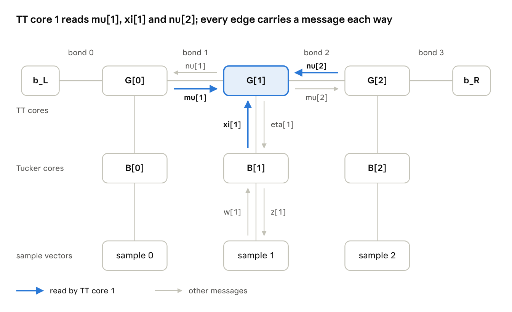

# T3Toolbox sampling layer: graded messages proposal

> **Status after the review of 2026-11-14.** The network, the algebra, the frame analysis and the evidence stand. Parts of the design below were changed; read [DESIGN_AFTER_REVIEW.md](DESIGN_AFTER_REVIEW.md) first. Where the two disagree, that one wins. This document has not been rewritten.
>
> What changed:
>
> - **"Components are keyed by grade" and "Layer 1: operands know their stacks".** There is no graded container and no operand object. Every variable is its own array and every function takes exactly the arrays it reads. The generic graded program (`gmul`, `PointedCore`) is kept as the derivation and the test twin only.
> - **The names.** The name table is to become a token map with `_dot`, `_tilde`, `xi_term` and the rest (section 3 of the design document). The letter under the tilde moves.
> - **The names, since 2026-11-15 (23:23).** The names are those of [SAMPLE_VARIABLES.md](SAMPLE_VARIABLES.md); the earlier names and the ideas between are in [NOTATION_HISTORY.md](NOTATION_HISTORY.md) (its section 1 has a table from this document's names). This document's grades map as: `_z` -> `_tilde`; `_t` in a manifold frame (the frame's form) carries a basis in its name: `xi_t` -> `xi_U_dot`, `mu_t` -> `mu_R_dot`, `nu_t` -> `nu_L_dot`, `eta_t` -> `eta_D_dot`; `_t` at the corewise frame -> `_dot`; `_tz` -> `_tilde_dot` (`eta_tz` -> `eta_D_tilde_dot`, `nu_tz` -> `nu_L_tilde_dot`). `w_z` is `w_tilde`; `phi` is `z`; `z_t` and `phi_t` are `Jp`; `dB_z`, `dG_z`, `dB_tz`, `dG_tz` are `V_tilde`, `H_tilde`, `V_tilde_dot`, `H_tilde_dot`. In the table "Names" under "Correspondence with current names", two current names in one row are not always one variable: `sigmas` is `mu_R_dot` and `mus_dot` is `mu_dot`, `dxis` is `xi_U_dot` and `xis_dot` is `xi_dot` (one side in two bases); `taus` and `nus_dot` are both `nu_L_dot`, and `detas` and `etas_dot` both `eta_D_dot`. This document's "mode edge" (and "mode leg") is the Tucker edge of the new page, and its "ambient edge" is the page's mode edge.
> - **"A three-factor rule is evaluated as two binary graded products."** Withdrawn. Each term is one contraction (F5).
> - **Taylor jets.** Used internally, with the library's conventions kept at the boundary, so no user-visible convention has to change. This was demonstrated, not formally decided.
> - **Frame consistency.** A diagnostic, not a safe-mode precondition. `(D, L)` is the authoritative base point.
> - **"Computed once and cached."** The caller holds variables and passes them as keyword arguments.
> - **The order of work.** It has no steps for the evaluator, the plan or the scans, and it must be redone for the two stages, with structural slices gated by the library's bitwise battery (D5, F18).
>
> Known errors, from the reviewers: "pairing holds with no exceptions" is false in a manifold frame; the reviewer's statement is all four grades in the corewise frame, grade `t` in a manifold frame, and the tails only for plain and `z` (D6). "Tails above 1: not checked": they work in the current kernels and in the prototype (D21, F12). "Tails are not gauged" holds only for unsquashed frames, and default frames are squashed (D7). `p`, `t`, `s`, `r`, `B`, `K` and the rule name "R" each have two meanings (D8). `correspondence_check.py` prints membership, so its line "prototype has no component there: False ..." reads as the opposite of what is true (D8). "In general have different ranks" holds only at non-minimal points (D8).

Snapshot of the proposal as of 2026-11-14, against T3Toolbox commit `89ac203f`. Companion files:
[API_IMPACT.md](API_IMPACT.md), [WORKED_EXAMPLE.md](WORKED_EXAMPLE.md), [EXECUTION_PLANS.md](EXECUTION_PLANS.md)
and [EVALUATOR.md](EVALUATOR.md) (how a call is executed, and what it computes and keeps; added later, against
commit `3dc15d9`), [README.md](README.md) (how to resume).

## Summary

Every kernel in `entries.py`, `apply.py`, `probing.py` and `sampling_derivatives.py` is one of seven site rules, evaluated at one of four grades. The proposal is to write those rules once and derive everything else from them.

The four files hold 188 `contract` calls with 117 distinct subscript strings. Stripped of stack and order letters, they reduce to the seven rules and their two-operand factorizations.

The parts of the proposal, each with its own section below:

- **One generating function.** Everything is a derivative of the scalar `apply`. Probes are its gradient in the sample vectors, tangent operations are its derivative in the cores, and transposes are its core gradients with a residual inserted.
- **Names.** An edge variable is a directed edge plus a grade. Four letters (`xi`, `mu`, `nu`, `eta`) and four grades replace about thirty current names.
- **Network.** Bonds are numbered `0..d`, both tails are ordinary edges, and the boundary vectors are operands.
- **Frame.** Each frame family is the base point in a canonical form, so every family has `d` meaningful cores.
- **Jets.** Storing Taylor coefficients, with residual jets reversed, removes the binomial weights and makes every adjoint kernel a forward kernel.
- **Code.** A sweep is one rule string plus a list of operand tuples. The tuples can be generated from the grades.
- **Consistency.** The left and right canonical forms must represent the same tensor. A cheap check exists.

Status: a 300-line numpy prototype reproduces 34 library outputs to a worst relative error of 1.2e-15, and the intermediate edge variables match array by array. Performance is unproven, and nothing in T3Toolbox was modified.

## The network

The sampled T3 is a tree: a chain of `d` TT cores, a Tucker core hanging off each, a sample vector on each Tucker core, and a boundary vector closing each end of the chain.

$$
\Phi(\theta, w) \;=\; b_L^{\top}\, G_0(\xi_0)\, G_1(\xi_1) \cdots G_{d-1}(\xi_{d-1})\, b_R,
\qquad \xi_i = B_i\, w_i
$$

Here `G_i(xi_i)` is TT core `i` with its mode leg contracted against `xi_i`. This scalar is `apply`; every other sampling operation is a derivative of it.



```
 bond 0        bond 1        bond 2        bond 3
b_L ---- G[0] ------- G[1] ------- G[2] ---- b_R        TT cores
          |             |             |
         B[0]          B[1]          B[2]               Tucker cores
          |             |             |
       sample 0      sample 1      sample 2             sample vectors

Around site 1:  mu[1] ->  on bond 1,   <- nu[2]  on bond 2,   xi[1] up and eta[1] down on the mode edge,
                w[1] up and z[1] down on the ambient edge.  TT core 1 reads mu[1], xi[1], nu[2].
```

Core `i` sits between bond `i` and bond `i+1`. Each edge carries one message in each direction.

### Numbering

- **Bonds `0..d`.** Core `i` sits between bond `i` and bond `i+1`. This is the numbering `tt_ranks` already uses, so bond `i` has size `ranks[i]`.
- **Mode edge `i`** joins Tucker core `i` to TT core `i`. **Ambient edge `i`** joins sample vector `i` to Tucker core `i`.
- **Sites `0..d-1`.** Cores, sample vectors and everything on mode and ambient edges are indexed by site.

### Boundary vectors are operands

The two tails (bond 0 and bond `d`) are ordinary edges, closed by vectors `b_L` and `b_R` that default to ones.

- **Any tail size works.** `b_L` has size `ranks[0]` and `b_R` has size `ranks[d]`. Uniformly shaped cores, whose tails have the same size as every other bond, need no special handling.
- **Boundary vectors carry grades, like sample vectors.** The scalar residual of an apply transpose is a component of `b_R`. The zero start of a tangent sweep is the absence of a component of `b_L`.
- **One convention replaces three.** Today the kernels separately hard-code ones or zeros as initial carries, a sum over the terminal bond as closure, and a broadcast seed in `compute_sigma_hat`.

Because the network is a tree, cutting any edge splits it in two. A message on a directed edge is the contraction of everything on the side it comes from. All edge variables are messages.

## Edge variables

An edge variable is named by two things: the directed edge it lives on, and its grade. The base letter fixes the edge and direction; a suffix gives the grade.

### Base letters

| Letter | Edge | Direction | Indexed by | Count |
| --- | --- | --- | --- | --- |
| `w` | ambient | sample vector into Tucker core | site | `d` |
| `z` | ambient | Tucker core out to the sample slot | site | `d` |
| `xi` | mode | up, Tucker core to TT core | site | `d` |
| `eta` | mode | down, TT core to Tucker core | site | `d` |
| `mu` | bond | from the left | bond | `d+1` |
| `nu` | bond | from the right | bond | `d+1` |

### Grades

A grade records what has been swapped into the network on the side the message comes from.

| Suffix | Meaning | Current vocabulary |
| --- | --- | --- |
| none | nothing swapped | the frame variables |
| `_t` | one core replaced by its variation | "d" and "dot" variables |
| `_z` | one residual inserted | "tilde" and "hat" variables |
| `_tz` | both | the two-hole variables |

So the names are `mu`, `mu_t`, `mu_z`, `mu_tz`, and likewise for `xi`, `nu` and `eta`. With jets, each variable also carries a leading order axis.

The `_z` grade exists because a probe is the gradient of `apply` in the sample vectors. Pairing a residual with the probes is the derivative of `apply` along that residual, placed on the leaves. Tilde variables are therefore ordinary messages with one leaf swapped, not a separate adjoint species.

### Bond variables on every bond

Both families are defined on all `d+1` bonds, including both tails.

| | Bond 0 | Bonds `1..d-1` | Bond `d` |
| --- | --- | --- | --- |
| `mu[i]` | `b_L`, given | computed | terminal, computed |
| `nu[i]` | terminal, computed | computed | `b_R`, given |

Three rules hold with no exceptions:

- **Shape.** `mu[i]` and `nu[i]` have trailing dimension `ranks[i]`.
- **Site rule.** Core `i` reads `mu[i]`, `xi[i]` and `nu[i+1]`, and writes `mu[i+1]`, `nu[i]` and `eta[i]`.
- **Pairing.** The two messages on any edge contract to `apply`: `<mu[i], nu[i]>` on every bond, `<xi[i], eta[i]>` on every mode edge, `<w[i], z[i]>` on every leaf.

Keeping both tails for both families makes the families exact mirrors. Reversal maps bond `i` to `d-i` and site `i` to `d-1-i`, so a right sweep is a left sweep with no index adjustment.

### Pairs and adjoints

The partners are `mu` with `nu`, `xi` with `eta`, and `w` with `z`. For graded messages the pairing sums over the ways to split the grade between the two partners.

The adjoint of a message is its partner at the complementary grade. For example, the adjoint of `mu_t` is `nu_z`.

The pairs stay as separate letters rather than one letter with a direction suffix. Direction words are easy to misread, the three edge types have no common notion of "forward", and the four letters match the paper.

### Components are keyed by grade

A variable's grades are stored as separate arrays keyed by grade, not stacked on an axis, for two reasons:

- **Different stacks.** The sample stack `W` enters on leaves, the frame stack `C` on cores, and the tangent stack `K` on whichever seed carries it.
- **Different spaces.** In a manifold frame `mu` and `mu_z` live on the left-rank space while `mu_t` lives on the right-rank space. The `_t` grade flips the space and `_z` does not.

## Building blocks

Seven site rules and one closure are the entire tensor-network content of the sampling layer. Each rule contracts a core with the messages arriving on all but one of its legs, or forms the outer product of all arriving messages.

| Rule | Legs | Reads | Writes | Driver |
| --- | --- | --- | --- | --- |
| UP | `io,o->i` | `B[i]`, `w[i]` | `xi[i]` | per site |
| RIGHT | `a,aib,i->b` | `mu[i]`, `G[i]`, `xi[i]` | `mu[i+1]` | sweep, left to right |
| LEFT | `aib,i,b->a` | `G[i]`, `xi[i]`, `nu[i+1]` | `nu[i]` | sweep, right to left |
| DOWN | `a,aib,b->i` | `mu[i]`, `G[i]`, `nu[i+1]` | `eta[i]` | per site |
| OUT | `i,io->o` | `eta[i]`, `B[i]` | `z[i]` | per site |
| GRAD_G | `a,i,b->aib` | `mu[i]`, `xi[i]`, `nu[i+1]` | gradient of TT core `i` | per site |
| GRAD_B | `i,o->io` | `eta[i]`, `w[i]` | gradient of Tucker core `i` | per site |
| CLOSE | `a,a->` | `mu[i]`, `nu[i]` | `apply` | any one bond |

There are only two drivers. A sweep threads a carry along the chain; a per-site map does not. LEFT is the mirror of RIGHT, so one sweep driver serves both.

### The graded product

Every rule is multilinear, so its value at a grade is the product rule: one term for each way of distributing the grade over the factors, with each swap used at most once.

RIGHT at grade `t`, in a manifold frame, has three terms. They are today's `sigma` recursion:

$$
\mu^{t}_{i+1} \;=\; \mu^{t}_{i}\, R_i(\xi_i) \;+\; \mu_{i}\, H_i(\xi_i) \;+\; \mu_{i}\, U_i(\xi^{t}_i)
$$

RIGHT at grade `z` has two terms, because cores carry no residual. They are today's `tau_tilde` recursion:

$$
\mu^{z}_{i+1} \;=\; \mu^{z}_{i}\, L_i(\xi_i) \;+\; \mu_{i}\, L_i(\xi^{z}_i)
$$

At grade `tz` the same rule has six terms, which is today's dotted adjoint sweep. GRAD_G has three terms at `z` and nine at `tz`.

All terms of one sum have the same leg pattern. They differ only in which operand carries which grade, and therefore which stack.

### Order of evaluation

A component at some grade depends only on components at that grade or below. Evaluation therefore runs plain first, then `t` and `z` independently, then `tz`.

The plain components depend only on the frame and the samples. They are the reusable frame sweep, and the same ordering extends that reuse to the `z` components across Hessian directions.

## Operations as seeds and readouts

Every public sampling function runs the same rules. What distinguishes one from another is boundary data: which frame, which grades are seeded where, and which coefficient is read.

### The three sample types

| Sample type | Leaf | UP is | Residual enters at | Value is read by |
| --- | --- | --- | --- | --- |
| entries | a multi-index | a gather of Tucker-core fibers | the closing boundary vector | CLOSE |
| apply | a vector per mode | a contraction | the closing boundary vector | CLOSE |
| probe | a vector per mode | a contraction | the leaves, as `w_z` | OUT |

For apply and entries the residual is a scalar per sample and seeds `b_R` at grade `z`. Then `mu_z` and `xi_z` are identically zero and only `nu_z` is needed.

This is why the apply transpose never stores `nu` or `eta`: today's `sigma_hat` is `nu_z`, which is the residual times `nu`. The lean frame sweep is the general rule "do not compute components nobody reads".

### The operation families

| Operation | Frame | Seeded | Read |
| --- | --- | --- | --- |
| Value: `t3_apply`, `t3_entries`, `t3_probe` | corewise | nothing | `phi` or `z`, plain |
| Jacobian: `tv_apply`, `tv_entries`, `tv_probe` | manifold | variation cores at `t` | `phi` or `z` at `t` |
| Tangent transpose | manifold | residual at `z` | core gradients at `z` |
| Corewise transpose | corewise | residual at `z` | core gradients at `z` |
| Corewise Hessian term | corewise | directions at `t`, residual at `z` | core gradients at `tz` |

Each `*_derivatives` variant is the same row with the sample vector replaced by the jet `(w, p)`. Forward operations read every order; transposes and Hessian terms read one top coefficient.

### Outside this framework

- **Ambient transposes.** They return CP factors and involve no sweep. They stay as they are.
- **Uniform masking and packing.** The wrappers in `utv_sampling.py` and `ut3_sampling.py` are boundary code around the kernels and are unaffected.

One opportunity falls out of treating the leaf as a typed operand. For an index leaf, GRAD_B is a scatter-add. Today the entries transposes build dense one-hot vectors of shape `W` by `N` and contract them. The saving has not been measured.

## The frame

The frame cores are one core per site, in several gauges. Which gauge a rule uses is decided by where the varied core, the "hole", lies relative to that site.

### Pointed cores

| Frame core | Is core `i` when the hole is |
| --- | --- |
| `L[i]` | beyond its right bond |
| `R[i]` | beyond its left bond |
| `U[i]` | beyond its mode leg, in the Tucker core below |
| `H[i]` | this TT core itself |
| `D[i]` | not this Tucker core |
| `V[i]` | this Tucker core itself |

The selection rule needs no case analysis:

- **A message carrying `t` arrives on some leg.** The hole lies beyond that leg, so use the variant pointed there.
- **The core itself carries `t`.** Use the variation core.
- **Nothing carries `t`.** The hole lies ahead, beyond the leg the output leaves on, so use the variant pointed at the output leg.

This reproduces the choice of `R`, `H` and `U` in the `sigma` recursion above, and of `L` in the `tau_tilde` recursion. The corewise frame is the degenerate case in which all variants are the same core.

### Each family is a canonical form of the base point

Every family keeps `d` cores, and none of them is padding.

- **`L` family.** The base point as a left-canonical train. Cores `0..d-2` are left-orthogonal and core `d-1` is the non-orthogonal center.
- **`R` family.** The base point as a right-canonical train. Core `0` is the center and cores `1..d-1` are right-orthogonal.

So `(D, L)` and `(D, R)` are each a complete T3 for the base point. The consequences:

- **No special site in any sweep.** A center is selected only by plain flow off the end of the chain. That flow is the base point's own value, so the plain terminal `mu[d]` contracts with `b_R` to `apply` of the base point.
- **Rectangular storage.** Frame and variation families have the same length, which the uniform layout and the per-site operand tuples both need.
- **Tails are not gauged.** Gauge freedom acts on interior bonds only, so the two families agree on `ranks[0]` and `ranks[d]`. One boundary vector per tail suffices.
- **The centers must be the true remainders.** They must be finite, because zero carries multiply them, and the two forms must represent the same tensor. See the consistency section.

The mathematically minimal alternative, `d-1` cores per family indexed by interior edge, is rejected. Sweeps would need staggered operands at the first and last site, the frame would not stack against the variations, and the base point would need a separate home anyway.

### Combinations that do not exist

In a manifold frame some coefficient and rule pairs are undefined, and every rule call must therefore name the grades it wants.

- **Plain probe output.** There is no Tucker variant for a hole beyond the ambient leg.
- **Core gradient at grade `t`.** Its terms are gradients with respect to different variants and have different shapes.

Both are defined in the corewise frame, which is the only place they are needed.

## Taylor jets

Storing Taylor coefficients instead of derivatives, with residual jets stored in reverse order, removes every binomial weight and makes each adjoint kernel identical to a forward kernel. Factorials then appear only where data enters and leaves.

### The example: one step of the left sweep and its adjoint

Each leaf is `w + s p`, so the input jet on a mode is affine. For one core write the two matrices below, and let `p` be the highest order.

$$
A_0 = G_i\big(\xi_i^{(0)}\big), \qquad A_1 = G_i\big(\xi_i^{(1)}\big), \qquad A(s) = A_0 + s\,A_1
$$

**Today, forward.** The stored quantity is the derivative of order `t`. A product of jets is a binomial convolution, which collapses to two terms for an affine factor (`compute_mu_jets`):

$$
\mu_{i+1}^{(t)} \;=\; \sum_{r+s=t}\binom{t}{r}\,\mu_i^{(r)} A_s \;=\; \mu_i^{(t)} A_0 \;+\; t\,\mu_i^{(t-1)} A_1
$$

**Today, adjoint.** The reverse sweep is a binomial correlation (`_adj_prop`). It shifts the other way and has a different weight, so it needs its own kernels:

$$
\hat\sigma_i^{(s)} \;=\; A_0\,\hat\sigma_{i+1}^{(s)} \;+\; (s+1)\,A_1\,\hat\sigma_{i+1}^{(s+1)}
$$

**Proposed.** Change variables once, at the boundary:

$$
\hat\mu_t = \frac{\mu^{(t)}}{t!}, \qquad\qquad \rho_k = (p-k)!\;\hat\sigma^{(p-k)}
$$

Both steps become the same weight-free recurrence, which is multiplication by the polynomial `A(s)` truncated above order `p`:

$$
\hat\mu_{i+1,\,t} = \hat\mu_{i,\,t}\,A_0 + \hat\mu_{i,\,t-1}\,A_1, \qquad\qquad \rho_{i,\,k} = A_0\,\rho_{i+1,\,k} + A_1\,\rho_{i+1,\,k-1}
$$

### Why it works

With these variables, pairing a residual jet `c` with the output derivatives `y` is one coefficient of a product:

$$
\sum_t c^{(t)}\,y^{(t)} \;=\; [s^p]\;\rho(s)\,\hat y(s), \qquad \rho_k = (p-k)!\,c^{(p-k)}
$$

Multiplication by `A(s)` is self-adjoint under this pairing, because multiplication commutes. Truncation is harmless, since terms above order `p` never reach the top coefficient.

### The other kernels

- **Full convolutions**, where both factors run to order `p` (the `eta` combine). The order scan stays, but the carried jet is shifted without weights and the inverse factorials disappear.
- **Gradient assembly.** Only the top coefficient of a triple product is needed:

$$
\tilde H \;=\; [s^p]\;\hat\mu(s)\otimes\xi(s)\otimes\rho(s) \;=\; \sum_{r+s+k=p}\hat\mu_r\otimes\xi_s\otimes\rho_k
$$

- **Three product kernels suffice**, chosen by the known order support of the factors: affine times full, full times full, and top coefficients only.

In the grade picture, the jet variable is one more grade. Forward grades hold ordinary jets and residual grades hold reversed jets, so the rule code is the same at every grade.

### Numerical behaviour

Rounding error does not improve; overflow headroom does. Term by term the two formulations compute the same numbers up to one scalar per order, and floating point is scale-invariant away from overflow.

Measured in numpy float32 against a float64 run of the same formulation, on random T3s:

| Case | Order | Largest derivative | Largest Taylor coefficient | float32 error, derivative form | float32 error, Taylor form |
| --- | --- | --- | --- | --- | --- |
| `d` = 16, order 12 | 0 | 1.0e4 | 1.0e4 | 8.5e-7 | 9.5e-7 |
| `d` = 16, order 12 | 12 | 2.0e15 | 4.2e6 | 7.4e-7 | 1.5e-6 |
| `d` = 24, order 20 | 0 | 2.6e6 | 2.6e6 | 1.7e-6 | 1.4e-6 |
| `d` = 24, order 20 | 20 | 2.9e26 | 1.2e8 | 1.3e-6 | 1.5e-6 |

Transposed gradients show the same pattern, about 1e-6 in both forms.

Where the Taylor form helps:

- **Range.** float32 overflows at 3.4e38, and squares overflow from 1.8e19. With a perturbation three times the sample size (`d` = 16), the order-12 derivative reached 1e21; the Taylor coefficient was 2e12.
- **Balance across orders.** The Taylor form is the derivative form with residual weight `1/t!` per order. Unweighted derivative residuals at order 12 were about 1e11 larger than at order 0.
- **A clean recipe for float32 fits.** Divide the data by `t!` once on the host in float64, state the residual weights in Taylor coordinates, and run Taylor kernels. No number of size `t!` then exists on the GPU.

### When the data is already normalized

If the data is already rescaled so that the orders are similar in size, no further `t!` rescaling is needed, and adding one would be wrong.

- **Balance.** Dividing by `t!` is one particular per-order weight. A normalization chosen from the data supersedes it. Applying both double-counts and under-weights the high orders by `t!`.
- **Accuracy.** Per-order scalings do not change relative rounding error, so nothing is gained there either.
- **Inside the kernels.** The `t!` is a change of variables, not a normalization of the problem. It folds into the existing weights so the objective is unchanged:

$$
\hat r_t = \frac{r_t}{t!}, \qquad \hat\omega_t = t!\,\omega_t, \qquad \hat\omega_t\,\hat r_t = \omega_t\, r_t
$$

The recipe above is this conversion, composed with whatever weights are already in use. It is not an extra normalization step.

What an existing normalization may not cover is range inside the kernels, and that depends on where it acts. Rescaling the inputs, such as the perturbation vectors, tames the derivatives at the source in both forms. A weight applied to the kernel's output leaves the derivative-form intermediates carrying the `t!` growth, which is an overflow question only.

Probe derivatives vanish identically above order `d-1`, since a probe is a polynomial of that degree in `s`. High orders only arise with many modes.

## Expressing it in code

A sweep is specified by one rule string and a list of operand tuples, not by a list of strings. This works because every term of every sum has the same leg pattern.

### Layer 1: operands know their stacks

A rule names only core legs, such as `a,aib,i->b`. Each operand carries its own stack signature (`C`, `WC`, `KC`, `WKC`, `W`), so the grouped subscripts passed to `contract` are assembled rather than written.

This removes the hand-written `WKCa,Caib,WCi->WKCb` strings, the `len_C` and `len_W` arguments, and the separate `d`-prefixed strings for the uniform layout.

### Layer 2: explicit term lists

Each tuple fills the slots of the rule. `CARRY` marks the slot the sweep threads through.

```python
RIGHT = Rule('a,aib,i->b')

mu   = sweep(RIGHT, start=b_L,  terms=[(CARRY, L, xi)])
mu_t = sweep(RIGHT, start=zero, terms=[(CARRY, R, xi), (mu, H, xi), (mu, U, xi_t)])
mu_z = sweep(RIGHT, start=zero, terms=[(CARRY, L, xi), (mu, L, xi_z)])
```

This layer is a mechanical restatement of the current kernels. It is the level at which the algorithms in the paper can be read off the code. [WORKED_EXAMPLE.md](WORKED_EXAMPLE.md) is a complete fit step at this layer.

### Layer 3: terms generated from grades

Operands become graded: a dict from grade to array, or a frame core that selects its own variant. The term lists of layer 2 are then generated by the product rule.

```python
xi  = up(B, w)                  # mode edge, up
mu  = right(b_L, G, xi)         # bonds 0..d, from the left
nu  = left(G, xi, b_R)          # bonds 0..d, from the right
eta = down(mu, G, nu)           # mode edge, down
z   = out(eta, B)               # probes
dG  = grad_G(mu, xi, nu)        # TT core gradients
dB  = grad_B(eta, w)            # Tucker core gradients
phi = close(mu, nu)             # apply
```

These eight lines are the whole sampling layer. A public function chooses the frame, seeds the grades, names the grades it wants from each call, and reads a coefficient. `scripts/graded_messages_prototype.py` is this layer, unoptimized.

### Requirements on the drivers

- **Wanted grades are explicit.** Each call lists the grades to produce, both to skip unread components and because some do not exist in a manifold frame.
- **Generated step bodies are memoized.** A scan body must come from a factory cached on the hashable specification (rule, term table, signatures), as scan-body principle 4 (`docs/contributor/scan_body_principles.md`) requires. This reduces the number of distinct bodies.
- **Per-site concerns live in the per-site driver.** Summing or keeping `W`, and chunking along `W`, are options of the driver, written once.
- **Association order is part of a rule.** A three-factor rule is evaluated as two binary graded products. The order chosen fixes the intermediates, as an einsum path does.
- **Structured keys inside, Greek letters outside.** Internally a message is keyed by edge, direction and grade, so LEFT is generated from RIGHT by flipping direction.
- **The carry marker is a named singleton**, such as an enum member, not a bare `object()`, `None` or a string. It must print readably, survive pickling and be hashable.

## Correspondence with current names

Every current edge variable maps to one proposed name, by a relabeling at order 0 and by one of two scalings with jets.

### Conversion rules

With `p` the highest order and `old[k]` the order-`k` row of the current array:

- **F**, forward grades (plain and `t`): `new[k] = old[k] / k!`
- **R**, residual grades (`z` and `tz`): `new[k] = (p-k)! * old[p-k]`
- **same**: affine inputs with rows 0 and 1 only, where both factorials are 1
- **top**: the current output equals the top coefficient `new[p]`, with no factor

### Index conversion

| Current | Proposed | Change |
| --- | --- | --- |
| `mus[i]` and the other left-swept arrays | `mu[i]` | none; gains the terminal `mu[d]` |
| `nus[i]` and the other right-swept arrays | `nu[i+1]` | shifted by one; gains the terminal `nu[0]` |
| site arrays (`xis`, `etas`, and so on) | same index | none |

Today index `i` means "an input to core `i`" for both bond families. `mus[i]` is on bond `i` and `nus[i]` is on bond `i+1`, so the same-edge pair is `mus[i]` with `nus[i-1]`.

### Names

| Proposed | Current, plain code | Current, jet code | Space in a manifold frame | Rule |
| --- | --- | --- | --- | --- |
| `w` | `ww` | `w_jets` = (`ww`, `pp`) | `N` | same |
| `w_z` | `ztildes` | `ztildes` | `N` | R |
| `xi` | `xis` | `xi_jets` | `nD` | same |
| `xi_t` | `dxis`; `xis_dot` | `dxi_jets`; `xi_jets_dot` | `nU` | same |
| `xi_z` | `deta_tildes` | `deta_tildes` | `nD` | R |
| `xi_tz` | `deta_tildes_dot` | `deta_tildes_dot` | corewise only | R |
| `mu` | `mus` | `mu_jets` | `rL` | F |
| `mu_t` | `sigmas`; `mus_dot` | `sigma_jets`; `mu_jets_dot` | `rR` | F |
| `mu_z` | `tau_tildes` | `tau_tildes` | `rL` | R |
| `mu_tz` | `tau_tildes_dot` | `tau_tildes_dot` | corewise only | R |
| `nu` | `nus` | `nu_jets` | `rR` | F |
| `nu_t` | `taus`; `nus_dot` | `tau_jets`; `nu_jets_dot` | `rL` | F |
| `nu_z` | `sigma_tildes`; `sigma_hats` | `sigma_tildes`; `sigma_hats` | `rR` | R |
| `nu_tz` | `sigma_tildes_dot`; `sigma_hats_dot` | same names | corewise only | R |
| `eta` | `etas` | `eta_jets` | `nU` | F |
| `eta_t` | `detas`; `etas_dot` | `deta_jets`; `eta_jets_dot` | `nD` | F |
| `eta_z` | `dxi_tildes`; `dxi_hats` | same names, 2 rows | `nU` | R |
| `eta_tz` | `dxi_tildes_dot`; `dxi_hats_dot` | same names, 2 rows | corewise only | R |
| `z` | `zs` | `z_jets` | `N` | F |
| `z_t` | result of `assemble_tangent_z` | result of `assemble_tangent_z_jets` | `N` | F |
| `phi` | result of `t3_apply`, `t3_entries` | result of `t3_*_derivatives` | scalar | F |
| `phi_t` | result of `tv_apply`, `tv_entries` | result of `tv_*_derivatives` | scalar | F |
| `dG_z` | `H_tildes` | `H_tildes` | TT core | top |
| `dB_z` | `V_tildes` | `V_tildes` | Tucker core | top |
| `dG_tz` | `dG` | `dG` | TT core | top |
| `dB_tz` | `dB` | `dB` | Tucker core | top |

### Reading the table

- **Two current names collapse into one in several rows.** `sigmas` and `mus_dot` are both `mu_t`: the first appears in the manifold tangent forward, the second in the corewise Hessian. The same holds for `taus` and `nus_dot`, `detas` and `etas_dot`, `dxis` and `xis_dot`.
- **Hats and tildes are one variable with different seeds.** `sigma_tildes` has the residual on the leaves. `sigma_hats` has the scalar residual seeding `b_R`.
- **`dxis` currently means two things.** In the tangent code it is `V` applied to `w`, which is `xi_t`. In `t3_probe_derivatives` it is `B` applied to `p`, which is row 1 of `xi`.
- **The Greek letters currently swap sides.** `sigma` comes from the left and `sigma_tilde` from the right, and likewise `tau`.
- **The two stored rows of `dxi_tildes` are the top two coefficients of `eta_z`.** `dxi_tildes[0]` is `eta_z[p]` and `dxi_tildes[1]` is `eta_z[p-1]`, exactly.
- **Boundary entries.** `sigmas[0]`, `taus[-1]`, `tau_tildes[0]` and `sigma_tildes[-1]` are identically zero today. In the proposal they are the absent or zero components of the boundary vectors.

## Frame consistency

A frame is consistent when `(D, L)` and `(D, R)` represent the same tensor. Library-built frames satisfy this, but nothing prevents a hand-built frame from violating it, and two parts of the code already read different families as the base point.

### What depends on it

| Reader | What it uses | Effect of an inconsistent frame |
| --- | --- | --- |
| Jacobian and its transpose | the centers only against zero carries, or in a discarded final carry | none, provided the centers are finite |
| `T3Frame.to_t3()` | `(D, R)` | returns the right-canonical point |
| `base_point(frame)` in `backend/geometry.py`, and the corewise Hessian hooks | `(D, L)` | uses the left-canonical point |
| Plain terminals, in this proposal | the centers directly | two different values of `apply` |

So the frontend's `to_t3` and the backend geometry already name different canonical forms as the base point. For a consistent frame all readers agree.

Measured on the library: replacing the two centers with other random values leaves all eight tangent operations bit-identical. Replacing them with NaN poisons the four forward operations and leaves the four transposes clean.

### Proposal

1. **Name one authoritative family.** Every reader of the base point uses the same canonical form. An inconsistent frame then has an unused slot, and nothing computes with two different points.
2. **Make the existing checker cheap.** `is_consistent()` already exists on `T3Frame` and `UT3Frame`. The ragged one densifies both reconstructions; the uniform one already subtracts and takes a norm.
3. **Treat it as a numerical precondition.** In the existing taxonomy that means safe mode only and eager only. Wire it at the operations that read the base point, not at the Jacobian or its transpose.

### The check

The ragged `is_consistent()` and the `to_t3` docstring both treat verification as a dense computation. It does not have to be.

- **Difference norm.** Subtract the two forms as T3s and take the norm, with the library's own subtraction and norm. No dense tensor is formed and the result is deterministic. Its noise floor is about 1e-12, against 1e-15 for the dense version.
- **Sample-based.** Apply both forms to a few random rank-1 samples and compare. It costs two apply sweeps and has no cancellation, but is probabilistic.

Measured on a frame from `T3Frame.from_t3`, and on the same frame with `R[0]` scaled:

| Frame | Dense residual | Difference norm | Eight random samples |
| --- | --- | --- | --- |
| Consistent | 1.2e-15 | 9.2e-13 | 1.0e-15 |
| `R[0]` scaled by 1 + 1e-3 | 1.0e-3 | 1.0e-3 | 1.0e-3 |
| `R[0]` scaled by 1 + 1e-9 | 1.0e-9 | 1.0e-9 | not run |

In the bond-indexed design the check is free whenever both sweeps run. The two plain terminals, `mu[d]` against `b_R` and `nu[0]` against `b_L`, must agree.

The same sweep also yields the forward value. The final carry that `compute_mu` discards today equals `apply` of the base point, to 4e-15 in the test.

## Performance

Each hand optimization in the current code is an instance of a generic mechanism in this design, so none needs to be given up. Whether the generic versions match the hand-written speed and memory is not yet measured.

| Current optimization | Generic mechanism |
| --- | --- |
| Frame-sweep reuse across the Jacobian and its transpose | Grade order: plain components are computed once and cached |
| Undotted adjoint state reused across Hessian directions | The same, for `z` components |
| Lean apply and entries sweep, without `nu` or `eta` | Components that nothing reads are not computed |
| `sigma_hat` recomputed from the residual instead of storing `nu` | `nu_z` seeded at the boundary vector |
| Factored TT Hessian assembly, four finals instead of nine | Associate as `mu` with (`xi` with `nu`) and take two graded binary products |
| Two-term banded recurrences fused into one GEMM | The affine-times-full product kernel |
| Order scans with one slice live | The full-times-full product kernel |
| Two read rows of `dxi_tilde`; order-summed assemblies | The top-coefficients-only product kernel |
| `W`-chunked gradient assemblies | An option of the per-site driver |
| Summed and unsummed twin bodies | An option of the per-site driver |
| Ragged and uniform twin strings | The driver adds the site axis |
| Mirroring through `tt_reverse` | LEFT is generated from RIGHT |
| `len_C` and `len_W` threading | Operand signatures |

Three costs are specific to the new design:

- **Term generation.** It runs in Python, once per trace under jit. In eager numpy it adds a small per-contraction overhead.
- **Bond arrays of length `d+1`.** Per-site maps read `mu[:-1]` and `nu[1:]`, which are copies on jax. They are small next to the contractions. If they matter, store the `d` core inputs plus one terminal and expose the bond view.
- **One contraction against a zero carry per tangent sweep**, at the site next to each center. This is the price of a rectangular scan body and exists today.

## Evidence

The algebra is checked numerically against T3Toolbox at commit `89ac203f`; performance and several layouts are not. All checks ran in numpy on CPU, in float64 unless stated. The scripts are in `scripts/`, and their recorded output is `scripts/expected_output_89ac203f.txt`.

### Checked

| Check | Result | Script |
| --- | --- | --- |
| Prototype against library outputs: 34 comparisons over value, Jacobian, tangent transpose and corewise Hessian term, for entries, apply and probe, at orders 0 and 3 | worst relative error 1.2e-15 | `graded_messages_prototype.py` |
| Intermediate edge variables against library jets at order 3: 13 families at the plain, `t` and `z` grades, under rules F and R | worst relative error 5.3e-16 | `correspondence_check.py` |
| Pairing identity at grade `t`, all orders: every bond, mode edge and leaf | at most 4e-16 | `pairing_check.py` |
| float32 against float64, both jet forms, up to order 20 | about 1e-6 in both forms | `f32_experiment.py` |
| Library centers replaced by other random values | 8 tangent operations bit-identical | `extra_core_experiment.py` |
| Library centers replaced by NaN | 4 forward operations poisoned, 4 transposes clean | `extra_core_experiment.py` |
| Bond of each library bond variable, read from trailing dimensions | left-swept arrays on bond `i`, right-swept on bond `i+1`, all 7 plain variants | `index_check.py`, `index_check2.py` |
| Library frame from `T3Frame.from_t3` | `(D, L)` and `(D, R)` both reproduce the T3 to 5e-15 | `frame_consistency_check.py` |
| Final carry discarded by `compute_mu` | equals `apply` of the base point to 4e-15 | `frame_consistency_check.py` |
| Non-dense consistency check by difference norm | floor 9.2e-13; resolves a 1e-9 inconsistency | `frame_consistency_nondense_check.py` |
| A full fit step at the explicit term-list layer | objective, gradient, Gauss-Newton Hessian product match to 7e-16 | `probe_fit_step_example.py` |

The prototype uses Taylor jets with reversed residuals, pointed frame cores, explicit boundary messages and bond-indexed `mu` and `nu`, so those parts of the design are exercised by the first two rows.

### Not checked

- **Speed and memory** of any generic kernel, on numpy or jax.
- **Stacks and layouts.** The prototype has one sample axis only: no `K` or `C` stacks, no kept `W`, no uniform layout, no chunking.
- **Tail sizes above 1.** The prototype's boundary vectors have size 1.
- **`tz` intermediates array by array.** Only the final Hessian outputs were compared.
- **jax and GPU behaviour**, including float32 on a GPU.
- **Callers.** `ut3_sampling.py` was not read in depth, and only part of `utv_sampling.py` was read.

## Risks, open questions and order of work

The main risk is performance parity; the algebra itself is settled. The work can be staged so that each step is tested against the code it replaces.

### Risks

- **Performance parity.** The fused GEMMs, the memory-lean order scans and the chunked assemblies must survive inside generic kernels. This needs benchmarks on the uniform jax path at realistic sizes.
- **Recompilation on eager jax.** Generated step bodies that are not memoized on their specification would recompile on every call.
- **Readability.** Generated term lists are less visible than hand-written ones. Printing the generated table, and testing it against the explicit lists, keeps the algorithms inspectable.
- **Index migration.** Right-swept arrays shift by one, so every consumer of `nus`, `taus`, `sigma_tildes` and `sigma_hats` changes.

### Open questions

- **Grade suffix.** `_z` uses the same letter as the probe output `z`. `_r`, for residual, is an alternative.
- **Bond storage.** True length `d+1` arrays, or `d` core inputs plus one terminal behind a bond view.
- **Authoritative family.** `T3Frame.to_t3()` reads the right-canonical form and the backend geometry's `base_point` reads the left. One must be chosen.
- **Default boundary vector on the padded uniform path.** Ones, which relies on masked cores, or the tail's rank mask.
- **Public jet convention.** Keep derivative-normalized inputs and outputs and convert at the boundary, or expose Taylor coefficients.

### Why not automatic differentiation

The structure here is what forward-over-reverse differentiation of `apply` would compute. Writing it as graded rules keeps what generic differentiation does not give: cached frame sweeps, a chosen stack on each component, memory-lean scans, and a numpy path.

### Order of work

1. **No kernel changes.** Write the naming and indexing convention down, add the edge-pairing identity as a test, and make the consistency checker cheap.
2. **Rules and explicit term lists** on plain `probing.py`, with operand signatures. Existing tests stay as they are.
3. **Grade expansion**, tested by comparing its generated term lists with the explicit ones from step 2.
4. **Bond-indexed arrays and boundary-vector operands**, including tails larger than 1.
5. **Taylor jets** with the three product kernels. Keep the current kernels as the oracle until speed and memory match.
